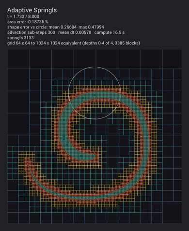

# Springls (Spring Level Sets)

A C++ implementation of spring level sets [1] in 2D and 3D: a mesh-free deformable-surface
representation that carries the interface on small, disconnected Lagrangian elements (*springls*)
advected by the flow, with a level set supplying the topology. Because springls have no
connectivity, they are resampled locally instead of re-meshed under large deformation, and the
surface changes topology freely. Alongside the original method it includes
**doubleweave** springls (two interleaved, staggered springl constellations), **adaptive**
variants on a block-adaptive quadtree / octree, and a **semi-Lagrangian doubleweave** that rebuilds
the level set from the springls every sub-step, so it has no CFL limit. Enright deformation tests
[2] for each method run with a GUI or headless.

<br clear="left">

**Full documentation, algorithm walkthroughs, results and videos: [rgb2hsv.github.io/springls](https://rgb2hsv.github.io/springls/)**

| Adaptive Springls 2D | Adaptive Springls 3D |
|:---:|:---:|
| [](docs/videos/adaptive-springls.mp4) | [](docs/videos/3d-adaptive-springls.mp4) |

<sub>Enright test: 64² base grid at depth 4 (2D) and 32³ base grid at depth 3 (3D). Click an image for the video.</sub>

## Build

```bash
git submodule update --init          # eigen, cereal, imgui, nanovg, argparse (not recursive)
cmake -S . -B build -G Ninja         # Release by default
cmake --build build
```

| option | default | effect |
|---|---|---|
| `SPRINGLS_USE_OPENMP` | `ON` | parallel loops when OpenMP is found (results are identical either way) |
| `SPRINGLS_BUILD_GUI` | `ON` | GLFW / OpenGL 3 window and frame export; `OFF` builds headless-only examples |
| `SPRINGLS_BUILD_EXAMPLES` | `ON` | build `enright2d`, `sl-enright2d`, `enright3d` and `sl-enright3d` |

The GUI needs GLFW 3.3+ (`libglfw3-dev`); without a system copy, initialize
`external/nanovg/external/glfw` and it is built from source. Then, for example:

```bash
./build/enright2d                    # 2D, all CFL-limited methods side by side
./build/enright3d -m adaptive-springls
```

## Attributions

The library depends only on [Eigen](https://eigen.tuxfamily.org) 3.4.0 and
[cereal](https://github.com/USCiLab/cereal) 1.3.2, both header-only submodules in `external/`, and
optionally OpenMP. The examples add [Dear ImGui](https://github.com/ocornut/imgui), a C++ port of
[NanoVG](https://github.com/rgb2hsv/nanovg), [GLFW](https://www.glfw.org) and
[argparse](https://github.com/p-ranav/argparse). The 2D code is a port of the springls in wedge.

1. B. C. Lucas, M. Kazhdan, and R. H. Taylor, "Spring Level Sets: A Deformable Model
   Representation to Provide Interoperability between Meshes and Level Sets," *IEEE Transactions
   on Visualization and Computer Graphics*, 2012.
2. D. Enright, R. Fedkiw, J. Ferziger, and I. Mitchell, "A Hybrid Particle Level Set Method for
   Improved Interface Capturing," *Journal of Computational Physics*, 183(1):83–116, 2002.

The [documentation](https://rgb2hsv.github.io/springls/#references) lists every reference used by the implementation.
If you use this code, please cite:

```bibtex
@article{lucas2012springls,
  author  = {Lucas, Blake C. and Kazhdan, Michael and Taylor, Russell H.},
  title   = {Spring Level Sets: A Deformable Model Representation to Provide Interoperability
             between Meshes and Level Sets},
  journal = {IEEE Transactions on Visualization and Computer Graphics},
  year    = {2012}
}
```
