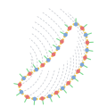
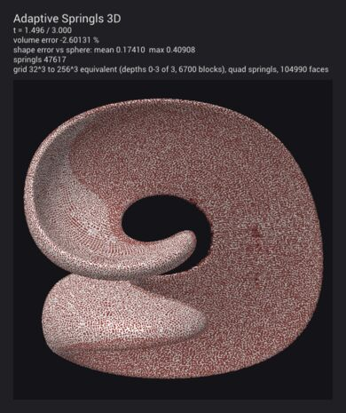
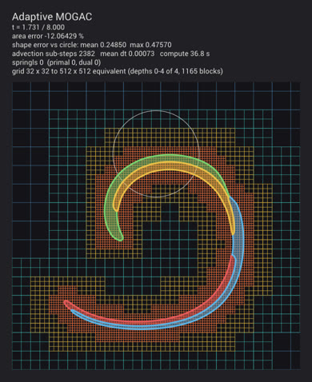
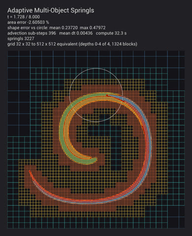
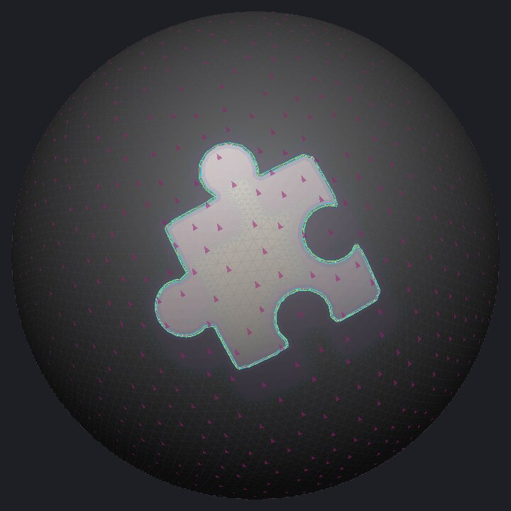
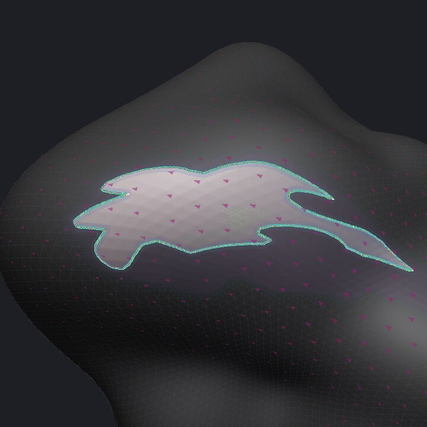

# Springls (Spring Level Sets)

A C++ implementation of spring level sets [1] in 2D and 3D: a mesh-free deformable-surface
representation that carries the interface on small, disconnected Lagrangian elements (*springls*)
advected by the flow, with a level set supplying the topology. Because springls have no
connectivity, they are resampled locally instead of re-meshed under large deformation, and the
surface changes topology freely. Alongside the original method it includes the **basic level set
method** (the same narrow-band level set the springls drive, moved by the flow itself with
first-order upwinding) as the Eulerian baseline,
**DoubleWeave** springls (two interleaved, staggered springl constellations), **adaptive**
variants on a block-adaptive quadtree / octree, and a **semi-Lagrangian DoubleWeave** that rebuilds
the level set from the springls every sub-step, so it has no CFL limit. Enright deformation tests
[2] for each method run with a GUI or headless.

<br clear="left">

**Full documentation, algorithm walkthroughs, results and videos: [rgb2hsv.github.io/springls](https://rgb2hsv.github.io/springls/)**

| Adaptive Springls 2D | Adaptive Springls 3D |
|:---:|:---:|
| [](docs/videos/adaptive-springls.mp4) | [](docs/videos/3d-adaptive-springls.mp4) |

<sub>Enright test: 64² base grid at depth 4 (2D) and 32³ base grid at depth 3 (3D). Click an image for the video.</sub>

| Adaptive MOGAC 2D | Adaptive Multi-Object Springls 2D |
|:---:|:---:|
| [](docs/videos/adaptive-multi-levelset.mp4) | [](docs/videos/adaptive-multi-springls.mp4) |

<sub>Multi-object Enright test: the disk split into four regions, 32² base grid at depth 4, T = 8. At t = T the level set (MOGAC) has lost two thirds of the area; the springls return all four regions inside the circle, losing 7.2% of the total area. The uniform runs are in the <a href="https://rgb2hsv.github.io/springls/#r-multi2d">documentation</a>.</sub>

## Build

```bash
git submodule update --init          # eigen, cereal, kdtree-cpp, happly, tinyvdb, imgui, nanovg, argparse (not recursive)
cmake -S . -B build -G Ninja         # Release by default
cmake --build build
```

The state after initialization is cached in the build directory as five files named after the source
mesh and a hash of the settings: `<mesh>-<hash>.levelset.vdb` (the adaptive level set as an OpenVDB file,
written with tinyvdb: a `phi_d<depth>` level-set grid per octree depth plus `blocks_d<depth>` structure
grids), and the cereal binary files `.state.cereal` (scalar simulation state), `.isosurface.cereal`,
`.primal.cereal` and `.dual.cereal` (each constellation's springls and its own level set). A later launch with the same mesh file (path, size, modification time) and settings
restores them instead of initializing (cosplay: 30.6 s to 3.2 s). Damaged or mismatched files are
ignored and rewritten.

| option | default | effect |
|---|---|---|
| `SPRINGLS_USE_OPENMP` | `ON` | parallel loops when OpenMP is found (results are identical either way) |
| `SPRINGLS_BUILD_GUI` | `ON` | GLFW / OpenGL 3 windows and frame export; `OFF` builds `toybox` and the programs headless |
| `SPRINGLS_BUILD_EXAMPLES` | `ON` | build `toybox` and, in `build/demo`, one program per implemented configuration (the `program` column of [Configurations](#configurations)) |
| `SPRINGLS_BUILD_TESTS` | `ON` | build the `springls-tests` unit tests; run them with `ctest --test-dir build` |

The GUI needs GLFW 3.3+ (`libglfw3-dev`); without a system copy, initialize
`external/nanovg/external/glfw` and it is built from source. Then, for example:

```bash
./build/toybox                              # 2D, the four CFL-limited single-object methods side by side
./build/demo/enright-3d-adaptive-springls         # one configuration per program (see Configurations)
./build/toybox -m multi                     # the six 2D multi-object methods; uniform grids default to 256, adaptive to 32 (1024 at depth 5)
./build/demo/enright-2d-adaptive-multi-springls
./build/demo/enright-2d-levelset                  # the basic level set method (also -adaptive-levelset, enright-3d-...)
./build/toybox -r springls,levelset                 # springls against the basic level set, uniform and adaptive
```

On Windows, configure with MSVC (the Visual Studio generator, or Ninja from a developer shell). No
extra packages are needed: GLFW is built from `external/nanovg/external/glfw` as above, and the GUI
programs load the OpenGL 3 entry points with the header-only glad loader in its `deps` folder. MSVC
uses its LLVM OpenMP runtime automatically. The programs land in the configuration's folder
(`build/Release/toybox.exe`).

```bash
cmake -S . -B build
cmake --build build --config Release
```

## Configurations

Every implemented configuration, as `toybox --list` prints it (a test keeps this table equal to the
registry). Each one has its own program, `build/demo/<scenario>-<domain>-<method key>`, which is
`toybox --domain <domain> --scenario <scenario> -m <method key>`.

| representation | domain | grid type | objects | scenario | interface tracking | method key | program | title |
|---|---|---|---|---|---|---|---|---|
| springls | 2d | uniform | single | enright | eulerian | `springls` | `enright-2d-springls` | Spring Level Set |
| springls | 2d | adaptive | single | enright | eulerian | `adaptive-springls` | `enright-2d-adaptive-springls` | Adaptive Springls |
| dweave | 2d | uniform | single | enright | eulerian | `dweave` | `enright-2d-dweave` | DoubleWeave |
| dweave | 2d | adaptive | single | enright | eulerian | `adaptive-dweave` | `enright-2d-adaptive-dweave` | Adaptive DoubleWeave |
| levelset | 2d | uniform | single | enright | eulerian | `levelset` | `enright-2d-levelset` | Level Set |
| levelset | 2d | adaptive | single | enright | eulerian | `adaptive-levelset` | `enright-2d-adaptive-levelset` | Adaptive Level Set |
| dweave | 2d | adaptive | single | enright | semi-lagrangian | `semi-lagrangian-dweave` | `enright-2d-semi-lagrangian-dweave` | Semi-Lagrangian DoubleWeave |
| levelset | 2d | uniform | multiple | enright | eulerian | `multi-levelset` | `enright-2d-multi-levelset` | MOGAC |
| levelset | 2d | adaptive | multiple | enright | eulerian | `adaptive-multi-levelset` | `enright-2d-adaptive-multi-levelset` | Adaptive MOGAC |
| springls | 2d | uniform | multiple | enright | eulerian | `multi-springls` | `enright-2d-multi-springls` | Multi-Object Springls |
| springls | 2d | adaptive | multiple | enright | eulerian | `adaptive-multi-springls` | `enright-2d-adaptive-multi-springls` | Adaptive Multi-Object Springls |
| dweave | 2d | uniform | multiple | enright | eulerian | `multi-dweave` | `enright-2d-multi-dweave` | Multi-Object DoubleWeave |
| dweave | 2d | adaptive | multiple | enright | eulerian | `adaptive-multi-dweave` | `enright-2d-adaptive-multi-dweave` | Adaptive Multi-Object DoubleWeave |
| springls | 3d | uniform | single | enright | eulerian | `springls` | `enright-3d-springls` | Spring Level Set 3D |
| springls | 3d | adaptive | single | enright | eulerian | `adaptive-springls` | `enright-3d-adaptive-springls` | Adaptive Springls 3D |
| dweave | 3d | uniform | single | enright | eulerian | `dweave` | `enright-3d-dweave` | DoubleWeave 3D |
| dweave | 3d | adaptive | single | enright | eulerian | `adaptive-dweave` | `enright-3d-adaptive-dweave` | Adaptive DoubleWeave 3D |
| dweave | 3d | adaptive | single | enright | semi-lagrangian | `semi-lagrangian-dweave` | `enright-3d-semi-lagrangian-dweave` | Semi-Lagrangian DoubleWeave 3D |
| levelset | 3d | uniform | single | enright | eulerian | `levelset` | `enright-3d-levelset` | Level Set 3D |
| levelset | 3d | adaptive | single | enright | eulerian | `adaptive-levelset` | `enright-3d-adaptive-levelset` | Adaptive Level Set 3D |
| dweave | 3d | adaptive | single | mesh | eulerian | `dweave` | `mesh-3d-dweave` | Mesh DoubleWeave |
| springls | surf | uniform | multiple | sphere | eulerian | `multi-springls` | `sphere-surf-multi-springls` | Surface Multi-Object Springls |
| springls | surf | uniform | multiple | stone | eulerian | `multi-springls` | `stone-surf-multi-springls` | Surface Multi-Object Springls |

Any other combination (3D multi-object, the `surf` domain) reports
`not implemented` with the nearest implemented configurations, and exits with code 2. For
multi-object level sets in 3D, see [mogac-openvdb](https://github.com/rgb2hsv/mogac-openvdb).

## toybox

`toybox` runs any implemented configuration, chosen by axes or by method key. Each axis takes one
value or a comma list; the runs are every implemented configuration of the product, side by side in
one window (or headless). One domain and one scenario per invocation.

| axis | flag | values | default |
|---|---|---|---|
| representation | `-r`, `--representation` | `springls`, `dweave`, `levelset` | the implemented ones |
| domain | `--domain` | `2d`, `3d`, `surf` | `2d` (`3d` for the mesh scenario, `surf` for sphere and stone) |
| grid type | `--grid-type` | `uniform`, `adaptive` | the implemented ones |
| objects | `--objects` | `single`, `multiple` | `single` |
| scenario | `--scenario` | `enright`, `mesh`, `sphere`, `stone` | `enright` |
| interface tracking | `--interface-tracking` | `eulerian`, `semi-lagrangian` | `eulerian` |

`-m`/`--method <key>[,<key>...]` selects by method key instead, within `--domain` and `--scenario`
(the other axis flags cannot accompany it); `-m all` is the four CFL-limited single-object springl methods
in 2D and all five springl methods in 3D (the basic level set methods run with `-r levelset` or by key), and `-m multi` the six 2D multi-object methods. `-g`/`--grid` is the
grid size. `toybox --list` prints the table above, `--help` every flag.

```bash
./build/toybox --domain 3d -m dweave,adaptive-dweave
./build/toybox -r dweave --grid-type adaptive --interface-tracking eulerian,semi-lagrangian   # semi-Lagrangian vs CFL-limited, equal compute
./build/toybox -r dweave --grid-type adaptive --interface-tracking eulerian,semi-lagrangian --domain 3d
./build/toybox --objects multiple --grid-type adaptive
./build/toybox --scenario mesh assets/model/cosplay.ply
```

Defaults depend on what runs (a selection with a semi-Lagrangian run uses that profile for all runs):

| profile | `-T` | `-d` | `--max-time-step` | `-g` | `--pacing` | `--substeps-per-step` |
|---|---|---|---|---|---|---|
| 2D Enright, Eulerian | 8 | 5 | none (CFL only) | 256 uniform, 32 adaptive | `lockstep` | method default |
| 2D Enright, with semi-Lagrangian | 8 | 2 | 1/50 | 128 | `equal-compute` | 1 |
| 3D Enright, Eulerian | 3 | 3 | 1/800 | 128 uniform, 32 adaptive | `lockstep` | method default |
| 3D Enright, with semi-Lagrangian | 3 | 2 | 1/50 | 32 | `equal-compute` | 1 |
| mesh | | `auto` | | from the mesh | | |

Flags that do not apply to the selected domain and scenario (for example `--elements` in 2D, `--csv`
in the mesh scenario) are rejected with an error naming them.

## Mesh scenario

`mesh-3d-dweave` (`toybox --scenario mesh`) loads a PLY mesh, splats it into an adaptive octree with exact signed distances,
seeds adaptive DoubleWeave springls and steps relaxation and resampling with no flow. It shows the
iso-surface and the primal and dual springls with matcap shading, and triplanar slices of the octree.

```bash
./build/demo/mesh-3d-dweave                              # loads assets/model/metasphere.ply
./build/demo/mesh-3d-dweave assets/model/cosplay.ply
./build/demo/mesh-3d-dweave mesh.ply --no-gui            # initialize, print statistics, exit
```

| option | default | effect |
|---|---|---|
| `mesh` | `assets/model/metasphere.ply` | PLY mesh to load (`assets/model/` also has `cosplay.ply` and `stone.ply`) |
| `--cell-scale` | `1` | finest cell size as a multiple of the mean edge length |
| `-g`, `--grid` | `0` | base cells along the longest axis (0: from the mesh's edge length) |
| `-d`, `--max-depth` | `auto` | adaptive refinement depth, an integer or `auto` (from the triangle count T: `round(log2(sqrt(T)/24))`, clamped to 1..10) |
| `-e`, `--element` | `quad` | springl element type, `quad` or `triangle` |
| `--matcap` | | GUI: matcap shading name (from `assets/matcap`) |
| `--set` | | tuning override `key=value`, repeatable |
| `--play` | off | GUI: start stepping after initialization (by default it stops there; Play and Step still work) |
| `--settle` | `20` | initialization ends with at most this many relax / contract / fill iterations, stopping early once an iteration removes and adds at most 0.01% of the springls |
| `--z-up` | off | GUI: the mesh's up axis is +z |
| `-j`, `--threads` | `0` | OpenMP threads (0: default) |
| `--cache-dir` | `build/cache` | where initial states are cached |
| `--no-cache` | off | initialize from the mesh without reading or writing the cache |
| `--no-gui` | off | run headless and print statistics |
| `--steps` | `0` | steps to run after initialization; in the GUI: run this many steps, then wait |
| `--screenshot` | | GUI: load, run `--steps` steps, write the window to this PNG and exit |

Mouse: left drag orbits, Shift + left drag or middle drag pans, right drag or the wheel zooms.
Large meshes take a while: a 600k-triangle mesh needs about 30 s to initialize and 90 s per step on a
20-thread machine. Work runs on a worker thread, so the window stays responsive.

## Sphere scenario

| Sphere (rotation) | Stone (Hodge flow) |
|:---:|:---:|
| [](docs/videos/sphere-surf-springls.mp4) | [](docs/videos/stone-surf-springls.mp4) |

<sub>The loop test with the puzzle piece, `--max-level 3`, at t = T/4. Click an image for the video; how intrinsic springls work is in the <a href="https://rgb2hsv.github.io/springls/#intrinsic">documentation</a>.</sub>

`sphere-surf-multi-springls` (`toybox --scenario sphere`) runs single-region springls on a triangle-mesh
surface (see Intrinsic springls). `stone-surf-multi-springls` (`toybox --scenario stone`) is the same on the
stone, `assets/model/stone.ply`: the icosphere smoothly distorted into a lumpy blob with bumps, dents and saddles
(radii 0.63 to 1.43; about 37% of its area saddle-shaped, 18% concave), built in Blender by
`assets/model/make_stone.py`; it takes the same options. An object (a jigsaw puzzle piece or a star, one region) goes once
around the z axis and comes back, advected semi-Lagrangian by one of two flows (`--flow`):

- `rotation` (the sphere's default): the rigid rotation ω ẑ × (x − c), projected onto each face. On a sphere it is
  divergence-free; on any other surface the projection compresses and stretches, so areas drift.
- `hodge` (the stone's default): the divergence-free part of that projected rotation by the Helmholtz-Hodge
  decomposition (`src/mesh/HodgeDecomposition.hpp`). The rotation X, sampled per input face, splits into an
  exact part ∇φ, a co-exact part n × ∇ψ and a small remainder (no harmonic fields on a genus-0 surface), φ and ψ
  piecewise linear, each from one cotan Poisson solve. The flow is n × ∇ψ: exactly divergence-free (the same flux
  through each edge from both faces), its streamlines the level sets of the stream function ψ, so it carries
  area exactly. It is scaled so the object's center moves at `--speed`, and the period is twice the traced time
  for the center to come around its streamline. The run's first lines give the removed exact part's share of |X|.

The mesh refines adaptively near the springls
(`--max-level`) and is rebuilt from the input mesh once enough refined area lies behind them (coarsening) and the window draws the refined triangulation, so regions and isolines follow it. The window shows the surface
(default: a built-in unit icosphere with 10242 vertices; the `mesh` argument loads a closed PLY such as
`assets/model/metasphere.ply`), the region, the springls, the contour, advection arrows over the whole
surface (they flip at T/2), isolines of the level set in the band, and the Lagrangian reference (yellow): the initial contour's points
advected by the flow alone.

```bash
./build/demo/sphere-surf-multi-springls                          # GUI, icosphere, puzzle piece
./build/demo/sphere-surf-multi-springls assets/model/metasphere.ply --object star
./build/demo/sphere-surf-multi-springls --no-gui --csv out/sphere.csv
./build/demo/sphere-surf-multi-springls --screenshot out/sphere.png --steps 100
./build/demo/sphere-surf-multi-springls --frames out/sphere --every 10 --frame-size 720
./build/demo/stone-surf-multi-springls --object star              # GUI, the stone, Hodge flow
./build/demo/stone-surf-multi-springls --flow rotation            # the projected rotation instead
```

| option | default | effect |
|---|---|---|
| `mesh` | built-in icosphere (stone: `assets/model/stone.ply`) | closed triangle mesh (PLY) |
| `--object` | `puzzle` | `puzzle` or `star` |
| `--flow` | `rotation` (stone: `hodge`) | `rotation` or `hodge` (above) |
| `--speed` | `1` | speed of the object's center (mesh units per unit time) |
| `--loop-distance` | `0` | geodesic distance of the object's center from the loop center (0: automatic) |
| `--radius` | `0` | object size r (0: loop distance / 6) |
| `--max-level` | `3` | adaptive refinement levels near the springls |
| `--steps` | whole loop | steps to run (`0`: none, headless and in the window; GUI: then wait) |
| `--every` | `1` | `--frames`: an image every this many steps, and at the last |
| `--frames` | | directory for view-only images (needs the GUI build; works with `--no-gui`) |
| `--frame-size` | `720` | size of saved frames in pixels |
| `--screenshot` | | GUI: run `--steps` (or to the end), write the 1600 × 900 window to this PNG and exit |
| `--csv` | | per-step metrics, one row (label 1): `step,time,label,area,relative_area_error,mean_shape_error,max_shape_error,springls,reference_mean_distance,reference_max_distance,reference_max_gap` |
| `--hide` | | GUI: comma-separated layers to hide initially: `regions`, `isolines`, `springls`, `contour`, `arrows`, `reference` |
| `--no-follow` | off | GUI: start with the camera not following the object (by default it follows, framed on the object at about 3 r either side) |
| `--play` | off | GUI: start stepping after initialization |
| `--set` | | tuning override `key=value` (the 2D springls keys; lengths in h_t, the refined edge length: the mean input edge / 2^`--max-level`), repeatable |
| `-j`, `--threads` | `0` | OpenMP threads (0: default) |
| `--no-gui` | off | headless: prints an init line, per-step progress lines (including `ref <mean>/<max> h, gap <g> h`) and a summary |

The panel on the left has play and step, t / T, the springl count, the area change (one region) and the contracted and filled springl totals, the shape
error against the initial object (exact only at the end of the loop; dimmed until then) (mean and max), the reference distance (mean and max) and gap, layer toggles (regions, isolines,
springls, contour, arrows, reference), sliders for the isoline spacing (default 0.5 h, h = the refined edge length h_t; isolines
of the band's distance to the nearest region boundary, out to the band's width of 3.5 h) and
the arrow spacing and length (in H, the input mesh's mean edge length, so they do not shrink with `--max-level`; defaults 2 H and 1 H), follow object (on by default: the view tracks the area-weighted centroid of
the object's regions and looks at it along the surface normal) and reset view (frames the whole mesh). Mouse: left drag orbits, Shift + left drag or
middle drag pans, right drag or the wheel zooms.

The flow is an analytic rotation about the z axis (see Intrinsic springls), so the arrows do not
depend on the mesh.

## Intrinsic springls

`intrinsic-springls` (headless) runs springls on a triangle-mesh surface: springls are segments on
the mesh's intrinsic Delaunay triangulation, adaptively refined near them (`--max-level` levels below
the input mesh, the surface unchanged), the region's level set is rebuilt from the springls after
every advection sub-step (semi-Lagrangian), and everything moves and measures along the surface
(exponential map, local charts, fast marching). The scenario: an object (a jigsaw puzzle piece or a
star, one region) placed at geodesic distance ρ from the vertex nearest the +z pole, toward +x, is
carried by the rigid rotation ω ẑ × (x − c) about the z axis through the mesh's bounding-box center c
(projected onto the input faces; ω = speed / the object's distance from the axis) for one revolution
and back; the exact solution at the end is the initial object on any surface.

```bash
./build/intrinsic-springls                                   # metasphere, puzzle piece, whole loop: 1083 steps, ~5 min, 0.15 GB
./build/intrinsic-springls --mesh sphere.ply --object star --csv metrics.csv --frames frames
```

| option | default | effect |
|---|---|---|
| `--mesh` | `assets/model/metasphere.ply` | closed manifold triangle mesh (PLY) |
| `--object` | `puzzle` | `puzzle` or `star` |
| `--speed` | `1` | speed of the object's center (mesh units per unit time) |
| `--loop-distance` | `0` | ρ (0: an eighth of half the distance to the vertex nearest -z; the toybox uses the half) |
| `--radius` | `0` | object size r (0: ρ / 6) |
| `--max-level` | `3` | adaptive refinement levels near the springls |
| `--frames` | | directory for `frame_NNNNNN.ply` (input mesh, vertices colored by region) and `springls_NNNNNN.ply` (springls as 3D edges) every step |
| `--csv` | | per-step metrics, one row (label 1): `step,time,label,area,relative_area_error,mean_shape_error,max_shape_error,springls,reference_mean_distance,reference_max_distance,reference_max_gap` (lengths in the refined length scale) |
| `--steps` | whole loop | number of steps |
| `--set` | | tuning override `key=value` (the 2D springls keys; lengths in h_t, the refined edge length: the mean input edge / 2^`--max-level`), repeatable |
| `-j`, `--threads` | `0` | OpenMP threads (0: default) |
| `--verbose` | off | progress on stderr |

Results so far (one revolution and back, the exact end state is the initial object; lengths in h_t).
On the unit icosphere with 10242 vertices and no refinement (`--max-level 0`; star and puzzle piece with
r = π/12), 332 steps, about 15 s: star area −0.060%, shape 0.062 / 0.176 (mean / max); puzzle −0.139%,
0.055 / 0.158; no springl contracted or filled. On the 2562-vertex icosphere refined one level (the same
h_t): star −0.141%, 0.054 / 0.158; puzzle −0.091%, 0.049 / 0.154; none contracted or filled. The toybox
default (puzzle, 10242 vertices, `--max-level 3`): 2661 steps, about 29 min, 0.32 GB peak, area −0.003%,
shape 0.033 / 0.116, 1 springl contracted, none filled, 244690 vertices at the end.

The runner's default (metasphere, puzzle, ρ ≈ 11.9, r ≈ 2.0, `--max-level 3`): 1083 steps in
4.5 min on 16 threads, 0.15 GB peak, 66264 → 98060 vertices; area −0.17%, shape 0.54 / 2.29 (the
projected rotation shears the object on the bumpy surface, so it comes back less exactly than on the
sphere). The scenario's own automatic ρ (≈ 95, r ≈ 15.9, what the toybox uses on a mesh) does not fit
the metasphere: the outline's samples land too far apart on the surface; r = 12 there runs 1.2 s/step rising to 2.0 s/step
by step 300 with about 6000 steps to go and ~450 new vertices per step (no coarsening), i.e. hours. A
quarter of it (ρ ≈ 24, r ≈ 4) was still at step 1600 of about 2550 after 31 min (4 s/step, the object
sheared to 4500 springls), and with `--max-level 2` it finishes (18 min) but does not come back (area
+44%).

## Attributions

The library depends on [Eigen](https://eigen.tuxfamily.org) 3.4.0,
[cereal](https://github.com/USCiLab/cereal) 1.3.2,
[kdtree-cpp](https://github.com/rgb2hsv/kdtree-cpp) and [happly](https://github.com/nmwsharp/happly) (PLY
files), all header-only submodules in `external/`, [tinyvdb](https://github.com/syoyo/tinyvdb), and
optionally OpenMP. The programs add [Dear ImGui](https://github.com/ocornut/imgui), a C++ port of
[NanoVG](https://github.com/rgb2hsv/nanovg), [GLFW](https://www.glfw.org) and
[argparse](https://github.com/p-ranav/argparse). The 2D code is a port of the springls in wedge, and
the viewer's mesh-to-level-set follows wedge's MeshToLevelSet. The matcaps in `assets/matcap` are CC0,
from Blender (see `assets/matcap/license.txt`).

1. B. C. Lucas, M. Kazhdan, and R. H. Taylor, "Spring Level Sets: A Deformable Model
   Representation to Provide Interoperability between Meshes and Level Sets," *IEEE Transactions
   on Visualization and Computer Graphics*, 2012.
2. D. Enright, R. Fedkiw, J. Ferziger, and I. Mitchell, "A Hybrid Particle Level Set Method for
   Improved Interface Capturing," *Journal of Computational Physics*, 183(1):83–116, 2002.

The [documentation](https://rgb2hsv.github.io/springls/#references) lists every reference used by the implementation.
If you use this code, please cite:

```bibtex
@article{lucas2012springls,
  author  = {Lucas, Blake C. and Kazhdan, Michael and Taylor, Russell H.},
  title   = {Spring Level Sets: A Deformable Model Representation to Provide Interoperability
             between Meshes and Level Sets},
  journal = {IEEE Transactions on Visualization and Computer Graphics},
  year    = {2012}
}
```
